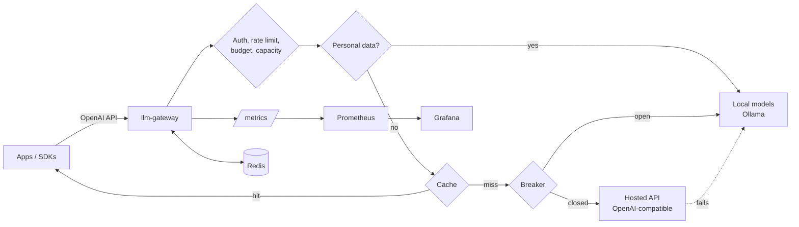

# llm-gateway

[](https://github.com/sillykea/llm-gateway/actions/workflows/ci.yml)

A self-hosted gateway that sits between your apps and your language models. Apps talk to one OpenAI-compatible endpoint. The gateway chooses the model, keeps personal data on your own hardware, routes around failing providers, enforces per-team rate limits and budgets, and shows you what it all costs.

It addresses the problems that appear as soon as more than one service starts calling LLMs. Every app grows its own keys and retry logic. Nobody can see the bill until it arrives. One provider outage takes every feature down with it. And customer data quietly ends up in a third-party API.



## Features

**One API, many backends.** Clients call `POST /v1/chat/completions` exactly as they would call OpenAI, so existing SDKs work after changing the base URL. Behind it you can mix Ollama with any OpenAI-compatible service (OpenAI, Azure, Groq, vLLM, LM Studio).

**Model aliases with fallback.** Apps ask for `chat-default`, not `gpt-4o-mini`. Each alias maps to an ordered list of targets. If a target returns a 5xx or 429, or times out, the gateway moves to the next one. A 4xx is returned straight away, because a bad request will fail everywhere.

**Circuit breakers.** A provider that keeps failing is skipped for a cooldown, so requests don't each wait out a timeout before falling back. After the cooldown, a single probe request checks whether it has recovered.

**Personal data stays local.** Requests are scanned for emails, phone numbers, card numbers (Luhn-checked), IBANs and IP addresses. The scan costs about 11 µs for a 4 KB prompt.

| `pii.mode` | Behaviour |
|---|---|
| `route_local` | Only providers marked `"local": true` are used (default) |
| `redact` | Matches are replaced with `[EMAIL]`, `[CREDIT_CARD]` and so on |
| `block` | The request is rejected with a 422 |
| `off` | No scanning |

**Streaming.** With `"stream": true`, tokens arrive as server-sent events in OpenAI's format, whichever backend answers. Fallback still works up to the first chunk, and streamed tokens count towards cost and budgets.

**Cost control.** Each key can have a `monthly_budget_usd`. Spend is estimated from token usage and per-model pricing, and requests are refused with `insufficient_quota` once the budget is reached.

**Overload protection.** Concurrent requests are capped. Past the cap, the gateway answers 503 straight away rather than queueing until everything times out.

**Zero-downtime config changes.** Send `SIGHUP` to reload the config. In-flight requests finish under the old config. An invalid config is rejected and the running one stays in place.

**Operable.** It exposes Prometheus metrics, provides a Grafana dashboard and alert rules, writes JSON logs with request IDs, and has health and readiness probes and graceful shutdown. A [runbook](docs/runbook.md) covers every alert.

Every response carries `X-Gateway-Provider`, `X-Gateway-Model`, `X-Gateway-PII`, `X-Cache` and `X-Request-ID` headers.

## Quick start

```bash
export OPENAI_API_KEY=sk-...        # optional, local models work without it
export GATEWAY_API_KEY=dev-key
docker compose up --build -d
docker compose exec ollama ollama pull llama3.1:8b
```

```bash
curl localhost:8080/v1/chat/completions -i \
  -H "Authorization: Bearer dev-key" \
  -H "Content-Type: application/json" \
  -d '{"model":"chat-default","messages":[{"role":"user","content":"Explain a token bucket in one line"}]}'
```

- Add `"stream": true` and `-N` to see the answer arrive token by token.
- Put an email address in the message and watch `X-Gateway-Provider` switch to `ollama`.
- Edit `configs/gateway.json`, then run `make reload` to apply it without a restart.

Grafana is at http://localhost:3000 and Prometheus at http://localhost:9090.

```python
from openai import OpenAI
client = OpenAI(base_url="http://localhost:8080/v1", api_key="dev-key")
client.chat.completions.create(model="chat-default", messages=[{"role": "user", "content": "hi"}])
```

## Configuration

Everything lives in [`configs/gateway.json`](configs/gateway.json). Secrets are never written in the file. Instead it names an environment variable (`key_env`, `api_key_env`). The whole config is validated before it's used, at startup and on every reload, and all errors are reported together.

| Section | Key settings |
|---|---|
| `api_keys` | `name`, `key_env`, `rpm`, `monthly_budget_usd` |
| `providers` | `name`, `type` (`openai`/`ollama`), `base_url`, `api_key_env`, `local`, `timeout_seconds` |
| `models` | alias → ordered list of `{provider, model}` |
| `pii` | `mode` |
| `cache` | `backend` (`memory`/`redis`/`off`), `redis_addr`, `ttl_seconds`, `redis_pool` |
| `limits` | `max_in_flight`, `breaker_threshold`, `breaker_cooldown_seconds` |
| `pricing` | model → `input_per_1k`, `output_per_1k` (USD) |

## Running on Kubernetes

```bash
cp deploy/k8s/secret.example.yaml secret.yaml   # fill in, never commit
kubectl apply -f secret.yaml -f deploy/k8s/
```

You get two or more replicas spread across nodes, an HPA, a PodDisruptionBudget, and a NetworkPolicy that limits who can call the gateway and where it can connect. Pods run as non-root with a read-only filesystem. A `preStop` delay and graceful shutdown mean a rolling deploy drops no requests.

## Performance

The gateway's own overhead is small next to model latency, but it sits in front of every call, so the hot paths are benchmarked (`make bench`):

| Operation | Time |
|---|---|
| Personal data scan, 4 KB prompt | ~11 µs |
| Rate limit check (parallel) | ~140 ns |
| Memory cache get/set (parallel) | ~440 ns |

The personal data scan was originally about 500 µs, because Go's regexp engine runs at around 8 MB/s on these patterns. Cutting the text into small candidate windows first (the text around each `@`, and runs of digits) and only running the patterns on those made it about 40x faster, with the same results.

## Development

```bash
make test    # go test -race ./...
make bench   # benchmarks
make lint    # gofmt, vet, staticcheck
make run     # run locally against configs/gateway.json
```

The tests spin up fake OpenAI, Ollama and Redis servers in-process, so they need no network or Docker. CI also runs staticcheck, govulncheck and the benchmarks, then builds and pushes a versioned image.

## Design

- [Architecture](docs/architecture.md): request lifecycle, how state survives reloads, failure modes
- [Threat model](docs/threat-model.md): what is protected, and the known gaps
- [Runbook](docs/runbook.md): SLOs and what to do for each alert

Decision records:

1. [Standard library only](docs/adr/0001-standard-library-only.md)
2. [Fail closed on personal data, fail open on the cache](docs/adr/0002-fail-closed-on-personal-data.md)
3. [Rate limits, budgets and breakers per replica, for now](docs/adr/0003-per-replica-state.md)
4. [Only fall back before the first streamed byte](docs/adr/0004-streaming-fallback.md)
5. [Shed load instead of queueing](docs/adr/0005-load-shedding.md)

## Roadmap

- Shared rate limits and budgets in Redis (design in ADR 3)
- OpenTelemetry tracing across gateway and providers
- Embeddings endpoint
- Semantic caching with vector similarity
- Detecting names and addresses with a small local NER model

## License

MIT
