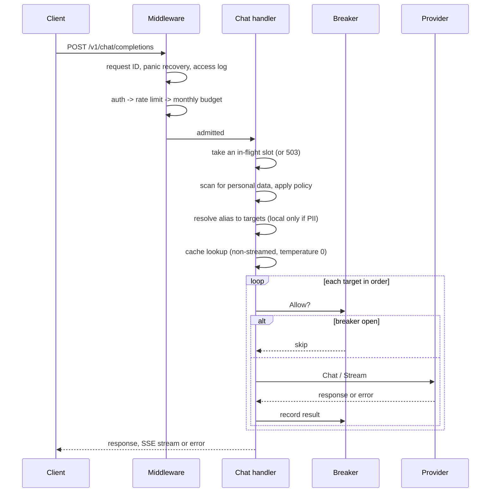

# Architecture

## Request lifecycle



Each stage can end the request early, and the order is deliberate. The cheap
checks (auth, rate limit, budget, capacity) come before any parsing or
network calls. Privacy decisions come before routing, so routing can never
choose a provider the policy rules out.

## State and reloads

There are two kinds of state:

| Kind | Examples | Lifetime |
|---|---|---|
| Config-derived | API keys, routes, limits | Replaced as one unit on `SIGHUP` |
| Operational | rate-limit buckets, budgets, breakers, metrics, cache | Lives as long as the process |

Config-derived state sits behind an `atomic.Pointer`. A request loads it once
at the start and uses that copy throughout, so a reload can't change the
rules part way through a request, and no locks are needed on the hot path.
Operational state is keyed by stable names (key name, provider name), so it
carries over a reload. If a new config fails validation, it's rejected and
the old one keeps running.

## Packages

```
cmd/gateway         process lifecycle: signals, reload, graceful shutdown
internal/server     middleware chain and the chat pipeline
internal/router     alias -> ordered targets, local-only filtering
internal/provider   OpenAI-compatible and Ollama clients, streaming
internal/breaker    circuit breaker per provider
internal/budget     monthly spend per key
internal/ratelimit  token bucket per key
internal/pii        windowed personal data detection and redaction
internal/cache      LRU and pooled Redis (RESP, optional TLS + AUTH) backends
internal/metrics    Prometheus text exposition
internal/config     loading, defaults, validation
```

Dependencies only point inward: `server` uses everything, and nothing uses
`server`. Each package can be tested in isolation, and the providers are
tested against `httptest` servers, not mocks of their own interfaces.

## Failure modes

| What fails | What the gateway does |
|---|---|
| A provider returns 5xx, 429 or times out | Falls back to the next target. Repeated failures open its breaker. |
| A provider returns 4xx | Returns it to the client unchanged. The breaker is not affected. |
| Every target's breaker is open | 503 with `Retry-After` set to the cooldown |
| Redis is down | Cache misses, requests carry on. `/readyz` reports not ready. |
| Too many concurrent requests | 503 with `Retry-After: 1` (load shedding) |
| Personal data and no local target | 422 rather than send it to a hosted provider |
| Stream breaks after the first chunk | An error event inside the stream, no fallback |
| Handler panics | 500 for that request only. Logged with stack trace and counted. |
| Bad config on reload | Rejected, old config kept, `config_reloads_total{result="error"}` |
